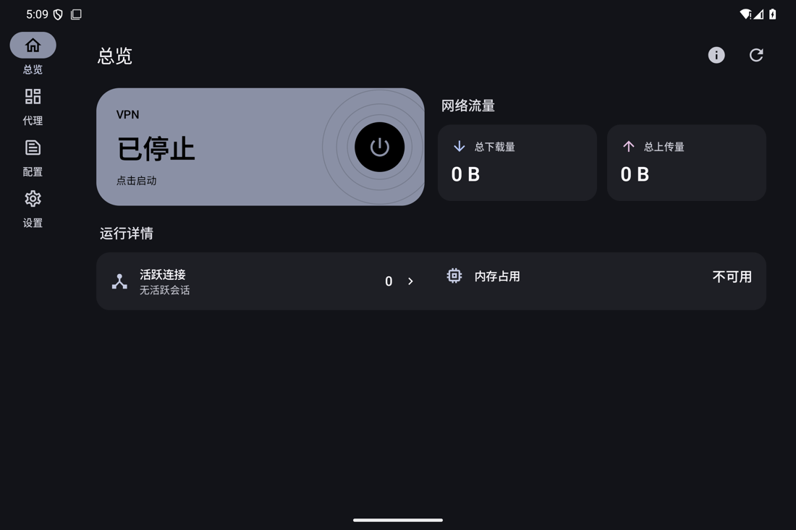

# clash-android

## 功能清单

- [x] 启停 VPN，按应用选择哪些流量经过代理
- [x] 切换代理组节点，批量测试组内节点延迟
- [x] 查看流量、内存占用和活跃连接，以及每条连接命中的规则和代理链
- [x] 导入本地 Clash 配置，校验并切换配置
- [x] 从订阅链接导入配置，手动更新订阅
- [ ] 在后台定时更新订阅
- [x] 通过 LocalSend 在局域网收发配置，可随配置分享订阅链接
- [x] 设置 IPv6、Fake IP、深色模式和界面缩放
- [x] 在应用内检查、下载并安装 GitHub 稳定版或测试版更新

## 软件截图

| 总览 · VPN 运行中 | 总览 · 深色模式 | 代理组选择 |
| --- | --- | --- |
|  |  |  |

**宽屏总览**

设置 · 界面缩放

在「设置 → 外观 → 界面缩放」中，可以使用设备推荐值，或按 5% 一档手动选择 75%–150%。

<!-- 更新截图时，用当前版本和示例配置截取对应页面，替换 docs/screenshots/ 下的同名 PNG。若画面内容变化，同步更新图注和替代文本。 -->

# Develop

每次修改 Rust 部分后使用 `generate-bindings` 更新绑定。

# Requirements

Android SDK & NDK

# Icon

The icon "wind" is provided by [loading.io](https://loading.io/icon/to8zzb)
