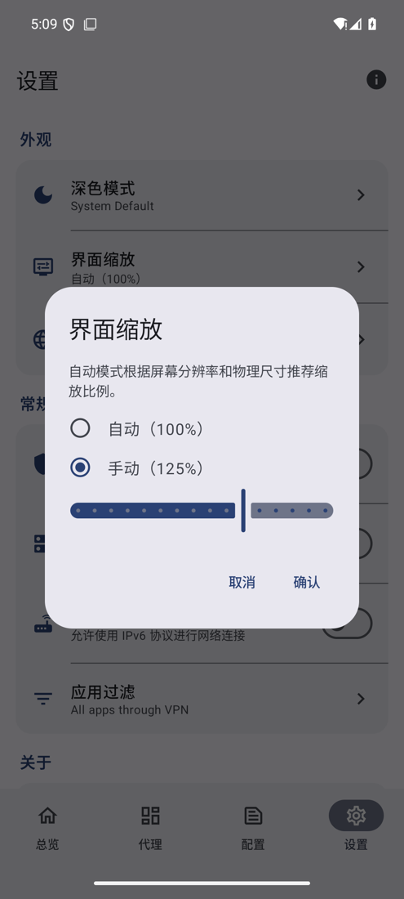

# clash-android

## 功能清单

- [x] 在 VPN 和 KernelSU TPROXY 之间选择，VPN 支持分应用代理，TPROXY 代理全设备
- [x] 切换代理组节点，批量测试组内节点延迟
- [x] 查看流量、内存占用和活跃连接，以及每条连接命中的规则和代理链
- [x] 导入本地 Clash 配置，校验并切换配置
- [x] 从订阅链接导入配置，手动更新订阅
- [ ] 在后台定时更新订阅
- [x] 通过 LocalSend 在局域网收发配置，可随配置分享订阅链接
- [x] 设置 IPv6、Fake IP、深色模式和界面缩放
- [x] 在应用内检查、下载并安装 GitHub 稳定版或测试版更新

## 使用 KernelSU TPROXY

在 KernelSU 管理器的「超级用户」中授权 Clash Android。停止当前代理，在「设置 → 代理模式」选择 KernelSU TPROXY，然后从首页启动。原有配置可直接使用。此模式通过内核的 TPROXY 和策略路由转发本机 TCP、UDP，保留 Android VPN 槽位。开启 IPv6 时，设备内核也需要支持 IPv6 TPROXY。

设置页的 TPROXY 专区默认开启「接管系统 DNS」，将非回环单播的 UDP/53 和 TCP/53 交给 Clash 配置的 DNS 解析器。Android 严格私人 DNS 和应用内 DoH 使用加密协议，不在此开关的接管范围内。切回 VPN 后可继续使用此前保存的分应用设置。

后台由一个原生进程加载 APK 中的 Clash 库。退出界面或在系统设置中强行停止 App 后，代理会继续运行。重新打开 App 可接管当前会话，点击首页的停止按钮会退出内核并清理规则。

如果代理内核本身意外退出，重新打开 App 会清理上次会话的规则，之后可以从首页再次启动。

## 软件截图

| 总览 · VPN 运行中 | 总览 · 深色模式 | 代理组选择 |
| --- | --- | --- |
|  |  |  |

**宽屏总览**

设置 · 界面缩放

在「设置 → 外观 → 界面缩放」中，可以使用设备推荐值，或按 5% 一档手动选择 75%–150%。

<!-- 更新截图时，用当前版本和示例配置截取对应页面，替换 docs/screenshots/ 下的同名 PNG。若画面内容变化，同步更新图注和替代文本。 -->

# Develop

每次修改 Rust 部分后使用 `generate-bindings` 更新绑定。

## 在模拟器测试代理流量

`traffic-test` 是可与 Clash Android 同时安装的测试应用，包名为 `rs.clash.traffictest`，支持 Android 10 及以上。它通过普通应用的默认网络发送 TCP、UDP 和系统 DNS 请求。

1. 在仓库根目录执行 `.\gradlew.bat :traffic-test:installDebug`，将「流量测试」安装到已连接的模拟器。
2. 在宿主机执行 `python traffic-test/echo_server.py`（Python 3.8+），保持终端打开。服务同时监听 `127.0.0.1:39007` 的 TCP 和 UDP。应用默认目标为 Android Studio 模拟器访问宿主机的地址 `10.0.2.2:39007`。
3. 关闭 VPN，在「流量测试」点击「运行全部测试」取得直连结果。Android 17 及以上访问本地服务时允许本地网络权限。每轮 TCP 和 UDP 各发送一个新编号，界面和服务端终端会显示对应编号。DNS 使用 Android 系统解析器，跳过设备 DNS 缓存，显示返回的 IP 地址。每项超时为 5 秒。
4. 在 Clash Android 的应用过滤设置中将测试应用纳入代理范围，启动代理后再次运行。要验证具体出站节点，可在**该节点能访问的机器**上运行 `python traffic-test/echo_server.py --bind <监听IP> --port 39007`，把应用目标改成服务端 IP，并让 Clash 规则将它转发到待测节点。确保 TCP 和 UDP 端口均可达。

IPv6 Fake IP 用例使用同一 DNS 查询域名。填写 Clash 的 `dns.fake-ip-range6` 和支持 HTTPS 的域名后，测试 App 会专门查询 AAAA，检查应答是否都落在预期网段，再连接其中一个 IPv6 地址的 443 端口并校验域名证书。结果会显示实际连接的地址和 TLS 版本。

回包通过表示本次请求获得了预期响应。确认出站路径时，对照服务端的请求编号、来源地址和 Clash 的规则或节点日志。`10.0.2.2` 适合宿主机直连基线，远端代理需要其自身可达的目标。DNS 结果反映当前解析配置，开启 Fake IP 时可能显示合成地址。

# Requirements

Android SDK & NDK

# Icon

The icon "wind" is provided by [loading.io](https://loading.io/icon/to8zzb)
