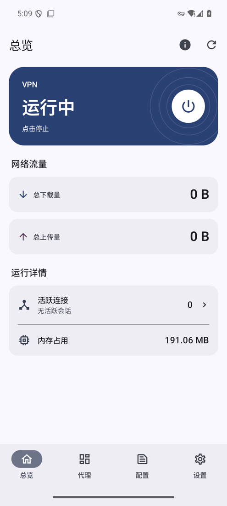

# clash-android

## 软件截图

| 总览 · VPN 运行中 | 总览 · 深色模式 | 代理组选择 |
| --- | --- | --- |
|  |  |  |

**宽屏总览**

设置 · 界面缩放

在「设置 → 外观 → 界面缩放」中，可以使用设备推荐值，或按 5% 一档手动选择 75%–150%。

<!-- 更新截图时，用当前版本和示例配置截取对应页面，替换 docs/screenshots/ 下的同名 PNG。若画面内容变化，同步更新图注和替代文本。 -->

## 局域网配置互传

在「配置」页打开配置卡片的菜单，选择「分享」，然后点选同一局域网内的 LocalSend 设备。订阅配置会发送当前文件副本。对端启用了 PIN 时，先填写 PIN 再点选设备；自动发现失败时，可输入对端的 IPv4 地址和端口。

接收时点「添加配置」，选择「从 LocalSend 接收」，点「下一步」并保持接收窗口打开。确认后，应用使用 Clash 校验文件，将有效配置另存为本地配置，同名配置自动编号。支持启用 HTTPS 的 LocalSend 客户端，每次传输一份文件，上限为 16 MiB。

# Develop

首次克隆后运行 `git submodule update --init localsend/upstream` 获取 LocalSend 协议库。
每次修改 Rust 部分后使用 `generate-bindings` 更新绑定。

# Requirements

Android SDK & NDK

# Icon

The icon "wind" is provided by [loading.io](https://loading.io/icon/to8zzb)
