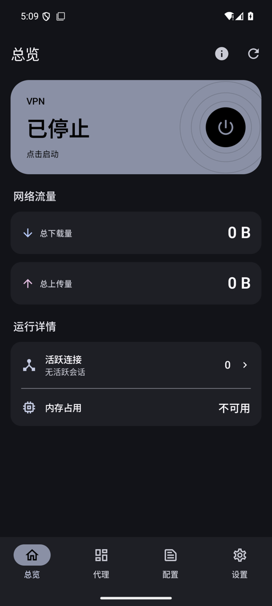

# clash-android

## 软件截图

| 总览 · VPN 运行中 | 总览 · 深色模式 | 代理组选择 |
| --- | --- | --- |
|  |  |  |

**宽屏总览**

窗口较窄或高度不足时使用底部导航。窗口宽度达到 600dp 时，下载和上传并排显示。达到 840dp 时，VPN 状态和网络流量也会并排显示。调整界面缩放后，布局按新的可用宽度重新选择。

设置 · 界面缩放

在「设置 → 外观 → 界面缩放」中，可以使用设备推荐值，或按 5% 一档手动选择 75%–150%。

<!-- 更新截图时，用当前版本和示例配置截取对应页面，替换 docs/screenshots/ 下的同名 PNG。若画面内容变化，同步更新图注和替代文本。 -->

# Develop

每次修改 Rust 部分后使用 `generate-bindings` 更新绑定。

# Requirements

Android SDK & NDK

# Icon

The icon "wind" is provided by [loading.io](https://loading.io/icon/to8zzb)
